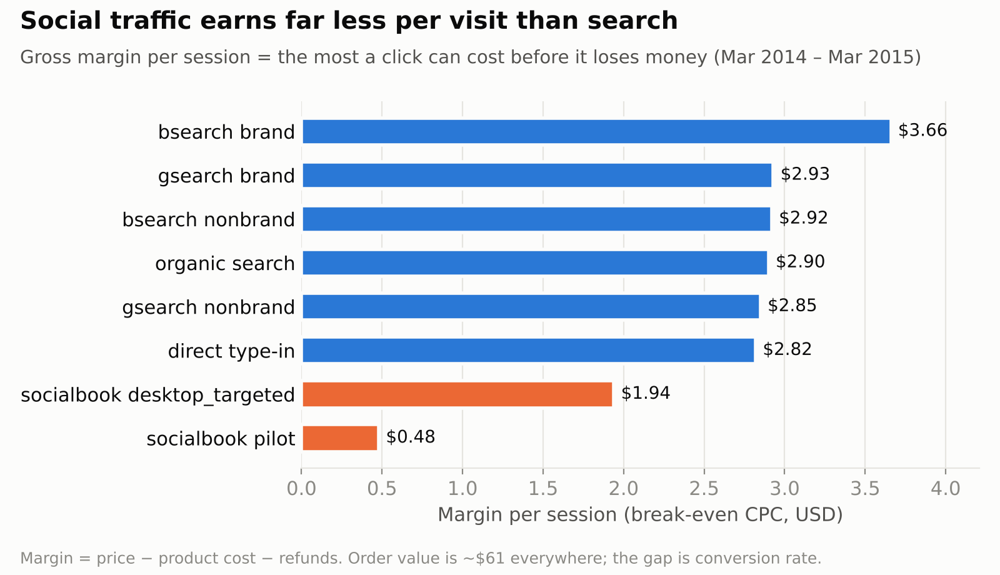
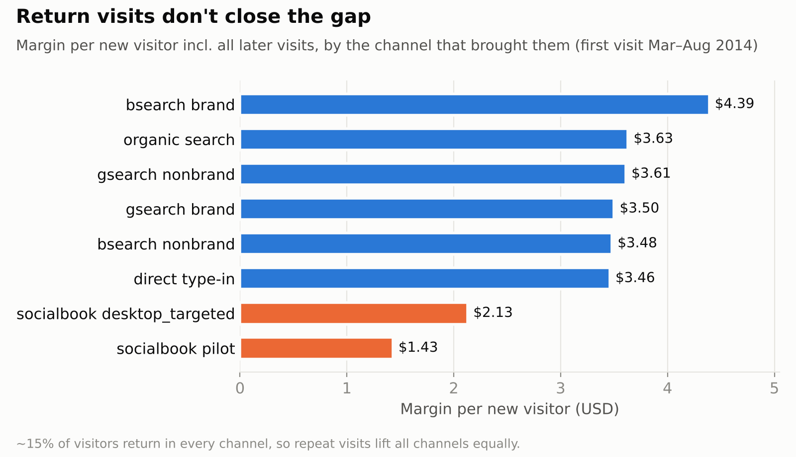
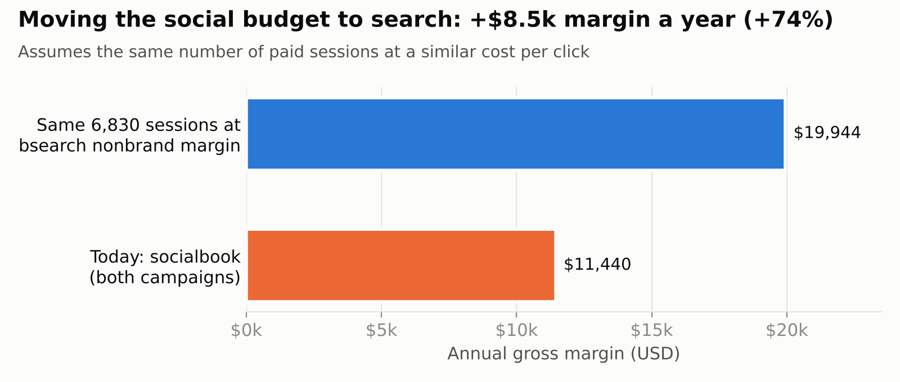

# Where Should the Next Marketing Dollar Go?

**Dataset:** Maven Toy Store e-commerce data (website sessions, orders, refunds), Mar 2014 – Mar 2015
**Tools:** SQL (PostgreSQL)

## Problem
The store gets traffic from paid search (gsearch, bsearch) and a social channel (socialbook). **Which channel should get less budget?** The data has no ad spend, so I compared channels by gross margin per session. This number shows the most we can pay for one click without losing money (break-even CPC).

## Findings
1. **Search earns $2.85–3.66 per session, social earns $0.48–1.94.** Average order value is about $61 in all channels. The difference comes from conversion rate: 7.5–9.6% in search, 5.2% and 1.1% in social.
2. **Returning visitors don't change the result.** About 15% of new visitors come back in every channel. When I count all their later visits, a visitor from search is worth $3.46–4.39 and a visitor from social is worth $1.43–2.13.
3. **Social is a small channel:** 2.7% of sessions and 1.6% of gross margin.

## Financial Impact
Social brought **6,830 sessions** and **$11.4k** gross margin. If these sessions earned the same as bsearch nonbrand, the margin would be **$19.9k**. That is **$8.5k more per year (+74%)**.

## Recommendation
1. **Stop the socialbook pilot.** One session earns only $0.48.
2. **Keep socialbook targeted only if** the cost per click stays below $1.94.
3. **Move the budget to bsearch nonbrand** and test it for 4–6 weeks. It earns the same per session as gsearch nonbrand but gets 5x less traffic.
4. **Use margin per session as the max bid** for all paid channels.

## Assumptions & Limits
- The data has no ad spend, so I assume one session = one paid click.
- The +$8.5k assumes bsearch nonbrand can get about 6.8k more sessions at a similar cost per click. More budget usually means higher cost per click, so this needs to be tested.
- Margin = price − product cost − refunds. In the per-visitor view (Q2) refunds are not subtracted.

---
Queries: [`sql/channel_value.sql`](sql/channel_value.sql)
